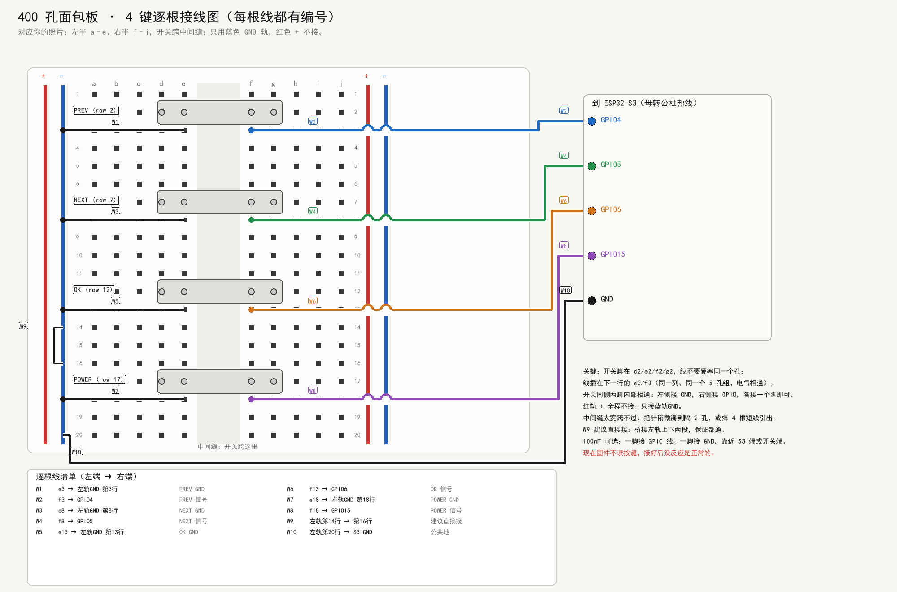
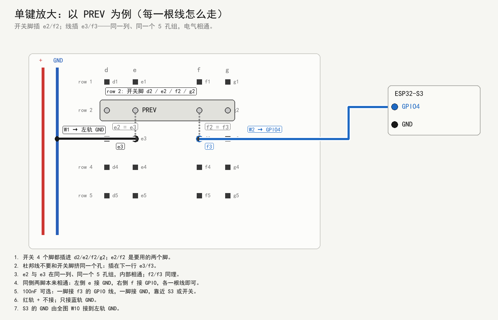

# 11 硬件与采购（v1 / v2）

> 状态：**采购建议，尚未下单/改硬件**。
> 适用：已经跑通"2.9 寸 296×128 墨水屏 + ESP32-S3"的现有板子。
> 架构见 [10-架构与接口.md](10-架构与接口.md)。

---

## 0. 先确认你现在的板子

项目默认按 **ESP32-S3-DevKitC-1 N16R8**（16MB Flash / 8MB PSRAM）写引脚，
见 [board_config.h](../firmware/src/board_config.h)。

- 如果你现在用的是 DevKitC-1 或兼容开发板：**不用再买主控**，直接加按键即可。
- 如果你用的是裸 ESP32-S3 模组：确认它已经有 3.3V 稳压、USB-C/串口下载、BOOT/RESET；
  没有的话，建议补一块 DevKitC-1 作为对照，省去电源/下载的调试时间。
- 屏幕、排线、S3 板都已经跑通，**不要再买第二块屏**。

---

## 1. v1 现在买什么（内部存储 + 4 键）

### 1.1 必买

| 物料 | 数量 | 参考价 | 用途 | 备注 |
|---|---|---|---|---|
| 6×6×5mm 轻触开关（4 脚） | 5–10 个 | ¥1–3 | PREV/NEXT/OK/POWER | 多买几个备换 |
| 400 孔面包板（你已有） | 0 | — | 按键台架 | 400 孔够 4 键 + 4 电容，不用换 830 |
| 杜邦线（公-公、母-母） | 各 10–20 根 | ¥5–10 | 按键到 GPIO/GND | 实际 6–10 根就够 |
| 100nF 瓷片电容 | 10 个 | ¥1 | 按键硬件消抖 | 推荐，但固件消抖也能先跑 |
| 10k 电阻 | 10 个 | ¥1 | 外部上拉/串联（可选） | 内部上拉也能跑，非必须 |
| 万用表（如果没有） | 1 台 | ¥30–60 | 通断、电压、µA 电流 | 接线验证/测深睡有用，非必须 |
| USB 电流表/功率计（可选） | 1 个 | ¥20–40 | 粗略看工作/待机电流 | 非必须 |

**合计约 ¥45–80**（不含已有 S3/屏）。如果已有万用表和面包板，实际只需 **¥10–20**。

### 1.2 建议顺手买（不接也能先跑）

| 物料 | 数量 | 参考价 | 用途 |
|---|---|---|---|
| microSD SPI 模块（3.3V） | 1 个 | ¥5–10 | v2 的 SD 卡验证 |
| 16GB microSD（FAT32） | 1 张 | ¥15–25 | 书库/页包 |
| 10k 电阻 + 100µF 电解电容 | 各几个 | ¥2 | SD 的 CS 上拉和电源缓冲 |
| 逻辑分析仪（可选） | 1 个 | ¥30–60 | 看 SPI/按键波形，非必需 |

> SD 现在不写代码，但可以先买着；**不要现在把 SD 接到 SPI 上**，等 v1 的存储层稳定后再加。

### 1.3 不要买

- 第二块墨水屏、第二块 S3 板（现有已够）。
- 5V 转 3.3V 的 AMS1117 大模块：静态电流大，电池方案会吃亏。
- 带 5V 电平转换的 SD 模块：能用但多一路耗电；优先 3.3V 原生模块。
- 昂贵的 PMIC/库仑计：v1/v2 用 TP4056 + ADC 就够。
- 蓝牙/WiFi 模块：S3 内置，不需要外购。

### 1.4 哪些是必须的？

| 物料 | v1 必须？ | 说明 |
|---|---|---|
| 4 个轻触开关 | **必须** | 没有按键就无法翻页/选择；买 5 个备一个 |
| 杜邦线 6–10 根 | **必须** | 4 根信号 + 1 根 GND + 电容地线；除非你直接焊 |
| 400 孔面包板 | 已有 | 够用；不用买 830 |
| 100nF 电容 | 推荐，非必须 | 没有也能靠固件 20ms 消抖；长线/产品板建议加 |
| 10k 电阻 | 非必须 | 固件用 `INPUT_PULLUP`；外部上拉只是更稳 |
| 万用表 | 非必须 | 没有就先用通断/后续测试固件验证；测深睡再买 |
| USB 电流表 | 非必须 | 只是看电流，不能替代 µA 表 |
| SD 卡/模块 | v1 不需要 | 等内部存储方案跑通再加 |
| 电池/充电模块 | v1 不需要 | v2 自研板再上 |

**结论：现在真正要下单的只有"4–5 个轻触开关 + 6–10 根杜邦线"；100nF 和 10k 顺手买，万用表没有可以先不买。**

### 1.5 400 孔面包板怎么摆

400 孔通常是两块 30×5 的端子排 + 两侧电源轨（有些没有电源轨）。4 个按键完全够：

1. **断电**，先不要插 USB。
2. 4 个轻触开关**跨中间凹槽**放，间隔 4–5 列，按 PREV/NEXT/OK/POWER 顺序贴标签。
3. 每个开关选**一侧**的两个脚作为信号端，接到 GPIO4/5/6/15；**另一侧**的两个脚全部接到 GND 母线。
   - 4 脚轻触开关同侧两脚内部相通；分不清就用**对角两个脚**当两端，最稳。
4. 如果装 100nF：一脚接对应 GPIO 所在行，另一脚接 GND 母线；尽量靠近开关。
5. 用一根杜邦线把 S3 的 GND 接到面包板 GND 母线；**不要**把 3.3V 接到按键上。
6. 用万用表通断档检查：按下时 GPIO 对 GND 导通，松开断开；相邻 GPIO 之间不能短路。
7. 确认无误后再插 USB；现有固件还不读按键，所以按键暂时不会有反应，这是正常的。

**只用上半段蓝色 GND 轨。** 你这块板的电源轨中间可能断开；4 个键都放在第 1–15 行，
用上半段就够，不需要把上下两段连起来。红色 `+` 轨全程不接按键。

布局建议：

```
        400 孔面包板（俯视，简化）
  ┌──────────────────────────────────────┐
  │  GPIO4   GPIO5   GPIO6   GPIO15      │  ← 4 根信号线
  │    │       │       │       │         │
  │  [PREV]  [NEXT]  [ OK ]  [POWER]     │  ← 开关跨中缝
  │    │       │       │       │         │
  │  ──┴───────┴───────┴───────┴──────   │  ← GND 母线
  │            100nF ×4（可选）           │
  └──────────────────────────────────────┘
```

- 屏的 8 根线保持原样（VCC/GND/DIN/CLK/CS/DC/RST/BUSY），不要为了按键挪屏线。
- 按键线尽量短，远离 SPI 的 CLK/MOSI；否则长线可能引入误触发。
- 面包板电源轨如果是分成两段的，记得把两段 GND 连起来。

---

## 2. 按键怎么接





> 你的 S3 板是**凸出的公针**，所以杜邦线买 **母转公（female-to-male）**：
> 母头插 S3 的针，公头插面包板。再备几根公-公做面包板内跳线即可。
>
> 4 脚轻触开关的针距约 4.5mm，面包板孔距 2.54mm，不完全对齐；
> 把针稍微掰到相隔 2 孔（5.08mm）就能插，或者买带 2.54mm 排针的按键模块。

### 2.1 逐根线清单

开关行：PREV=2、NEXT=7、OK=12、POWER=17。每个开关 4 个脚插 `d/e/f/g`，
杜邦线插在**下一行的 e/f**（同一列、同一个 5 孔组，电气相通），不要和开关脚挤同一个孔。

| 线号 | 从 | 到 | 用途 |
|---|---|---|---|
| W1 | e3 | 左轨 GND（第3行） | PREV 地 |
| W2 | f3 | GPIO4 | PREV 信号 |
| W3 | e8 | 左轨 GND（第8行） | NEXT 地 |
| W4 | f8 | GPIO5 | NEXT 信号 |
| W5 | e13 | 左轨 GND（第13行） | OK 地 |
| W6 | f13 | GPIO6 | OK 信号 |
| W7 | e18 | 左轨 GND（第18行） | POWER 地 |
| W8 | f18 | GPIO15 | POWER 信号 |
| W9 | 左轨第14行 | 左轨第16行 | 建议直接接，桥接上下两段 GND |
| W10 | 左轨第20行 | S3 GND | 公共地 |

> 你这块板的左轨中间看着有断口，**建议直接接 W9**；上下两段本来就通也没关系。
> 红轨 `+` 全程不接。

### 2.2 接线表

| 键 | ESP32-S3 | 另一端 | 说明 |
|---|---|---|---|
| PREV | GPIO4 | GND | `INPUT_PULLUP`，按下低 |
| NEXT | GPIO5 | GND | 同上 |
| OK | GPIO6 | GND | 同上 |
| POWER | GPIO15 | GND | 同上；不要开 UART0 硬件流控 |

每个键：

```
GPIOx ──┬── 轻触开关 ── GND
        │
       100nF
        │
       GND
```

- 100nF 尽量靠近按键/GPIO；长线可再加 1k 串联。
- 内部上拉约 45k，面包板短接线够用；产品板建议再加 10k 外部上拉到 3.3V。
- 按键另一端统一接 GND，不要接 3.3V（避免按错电源）。

### 2.3 注意

- GPIO15/16 是 UART0 的 RTS/CTS；如果以后用 UART0 硬件流控，要换脚。
- 不要用 GPIO0/3/45/46 做按键：它们是 strapping 脚，上电电平会影响启动。
- 不要用 GPIO19/20（USB）、26–37（Flash/PSRAM）、39–42（JTAG）。
- 按键线远离 SPI 排线，避免误触发/干扰。

### 2.4 两脚直插开关也可以

可以，而且更简单。只要是**常开、轻触（momentary）**的两脚开关：

```
GPIOx ── 开关 ── GND
```

- 一脚接 GPIO4/5/6/15，另一脚接 GND；内部上拉，按下读到低。
- 不需要 4 脚开关的"同侧相通"和 `e3/f3` 那一套；两根线直接接开关两个脚。
- 4 个开关的 GND 脚可以共用一根左轨 GND，再接到 S3 GND。
- 如果开关脚也插在面包板孔里，线插到**同一列的下一个孔**即可，别和开关脚挤同一个孔。
- 2 脚开关的针距常见 5mm，和 2.54mm 面包板也不完全对齐；掰针或焊短线引出。
- **不要用自锁开关**（按一下锁住、再按弹起）做翻页键，否则固件会一直读到低电平；
  自锁开关只适合做总电源开关。
- 100nF 仍然可选：并在开关两端（GPIO 与 GND）即可。

代码完全一样：固件只读 GPIO 高低，不关心开关是 2 脚还是 4 脚。

---

## 3. SD 卡怎么接（v2，先别接）

| SD 模块 | ESP32-S3 | 说明 |
|---|---|---|
| VCC | 3V3 | **不要 5V** |
| GND | GND | 共地 |
| CS | GPIO13 | 10k 上拉到 3.3V |
| SCK | GPIO12 | 与屏共用 |
| MOSI | GPIO11 | 与屏共用 |
| MISO | GPIO14 | 屏不用 MISO，正好留给 SD |

- 屏只写不读，所以 SCK/MOSI 可以共用；但 SPI 必须用**成对事务**，CS 不能同时拉低。
- SD 的 CS 必须 10k 上拉，否则上电可能误入 SD 模式，之后初始化失败。
- SD 模块 VCC 并 100µF + 0.1µF；SD 卡瞬时电流可能到 100–200mA。
- 先用 4MHz；稳定后再试 10–20MHz。
- 不要热插拔正在刷新的卡；先退出阅读/传输，再拔。

---

## 4. 电池/充电（v2 再买）

### 4.1 物料

| 物料 | 数量 | 参考价 | 说明 |
|---|---|---|---|
| 3.7V 锂聚合物 1000mAh 带保护板 | 1 | ¥15–20 | 不要买裸电芯 |
| TP4056 充电模块（带保护） | 1 | ¥2–5 | USB-C 输入，1A 可调 |
| ME6211C33M5G / XC6206P332MR | 2 | ¥1–2 | 3.3V LDO，静态电流小 |
| AO3401 P-MOS | 2 | ¥1 | 负载开关/自锁 |
| S8050 NPN | 2 | ¥1 | 拉 P-MOS 栅极 |
| 电阻 100k/10k/1k | 各 10 | ¥2 | 栅极上拉/限流 |
| 10µF/100nF | 各 10 | ¥2 | 电源去耦 |
| USB-C 16P 母座 | 1 | ¥1 | 充电/供电 |
| JST-PH 2.0 电池座 | 1 | ¥1 | 电池连接 |
| 自恢复保险丝/ESD（可选） | 若干 | ¥2 | 产品化再加 |

**合计约 ¥25–35**，不含外壳/PCB。

### 4.2 电源框图

```
LiPo → 保护板 → TP4056 → ME6211 3.3V → P-MOS → 3V3
                                      ↑
                            按键 / GPIO21 → NPN → P-MOS 栅极
```

- `PWR_HOLD`（GPIO21）在 `setup()` 第一行拉高，早于串口/屏初始化。
- 长按 POWER 1.5 秒：保存 → `epd.sleep()` → `PWR_HOLD` 拉低断电。
- USB 插入时不要硬切，改成深睡。
- 电池 ADC：1M/1M 分压到 **GPIO1**，100nF 滤波。
  - **不要用 GPIO3**：它是 strapping 脚，上电分压可能影响启动。
- LDO 不要用 AMS1117：静态电流可能几 mA，1000mAh 电池撑不了几天。

### 4.3 安全

- 锂电必须带保护板；不要短路、反接、过充。
- 第一次上电先串限流/保险；测极性再插电池。
- 充电时不要无人值守；外壳留散热。
- 3.4V 以下保存关机，避免过放。

---

## 5. 工具与测量

| 工具 | 用途 | 建议 |
|---|---|---|
| 万用表 | 通断、3.3V、µA 待机 | 必买（如果没有） |
| USB 电流表 | 工作电流/充电电流 | 可选 |
| 逻辑分析仪 | SPI/按键波形 | 可选，排障用 |
| 恒温烙铁/焊锡 | 产品板/排针 | v2 再买 |
| 热缩管/扎带 | 走线 | 几块钱 |

测深睡电流：

- 万用表 µA 档串在 3V3 或电池回路；注意表的内阻会造成压降。
- DevKitC-1 的 LDO/USB 电路可能让"深睡"到 mA 级；这是板子问题，不是固件。
- 自研板换 ME6211/XC6206 后再测，目标 < 50µA。

---

## 6. 采购优先级

| 优先级 | 买什么 | 什么时候 |
|---|---|---|
| P0 | 4 个按键、面包板、杜邦线、100nF | 现在，v1 台架 |
| P0 | 万用表（如果没有） | 现在，测通断/电流 |
| P1 | 10k 电阻、100µF、备用按键 | 现在，顺手 |
| P2 | SD 模块 + 16GB 卡 | v1 存储层稳定后 |
| P3 | 电池、TP4056、LDO、P-MOS/NPN、USB-C | v2 自研板前 |
| P4 | 外壳、PCB、连接器 | v2 结构定稿后 |

---

## 7. 一句话

**现在只需要买"4 个按键 + 面包板 + 杜邦线 + 100nF + 万用表"，约 ¥20–60；SD 和电池都等 v1 跑通再说。**
