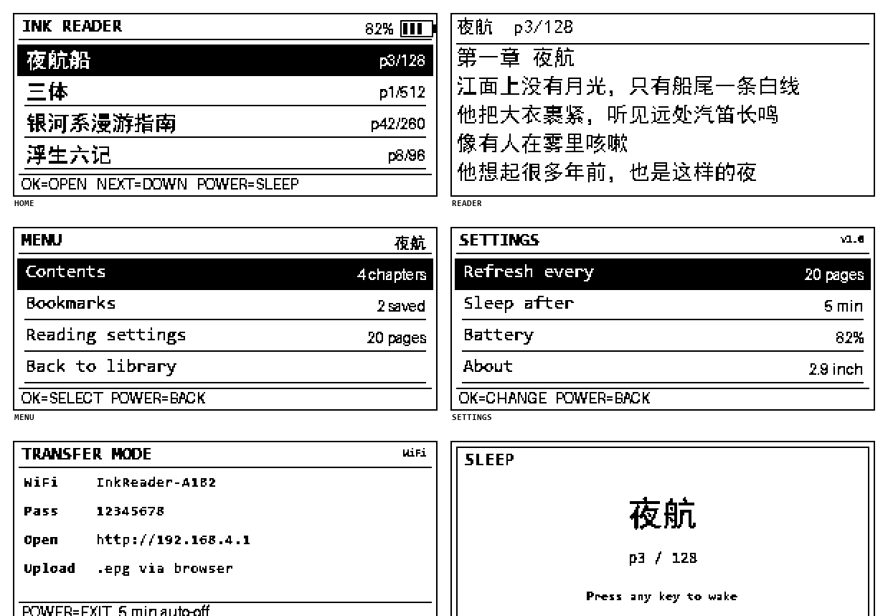
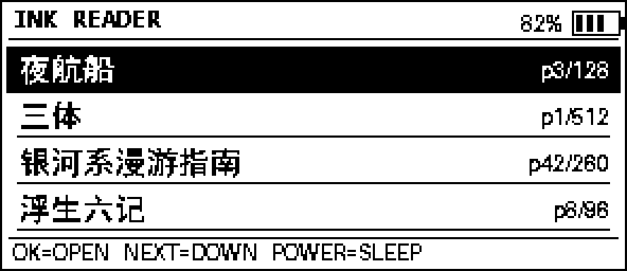
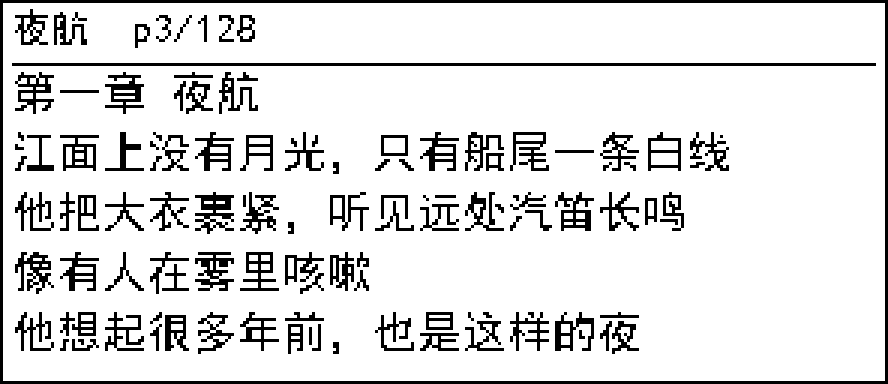
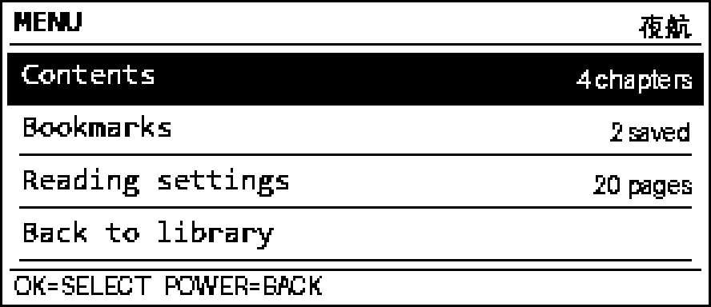
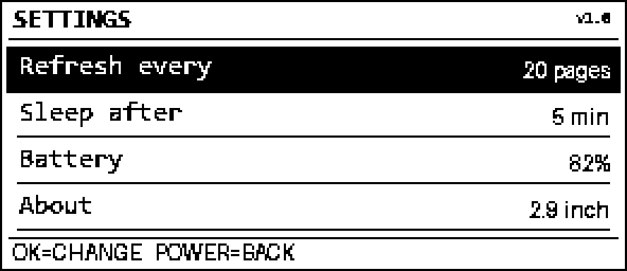
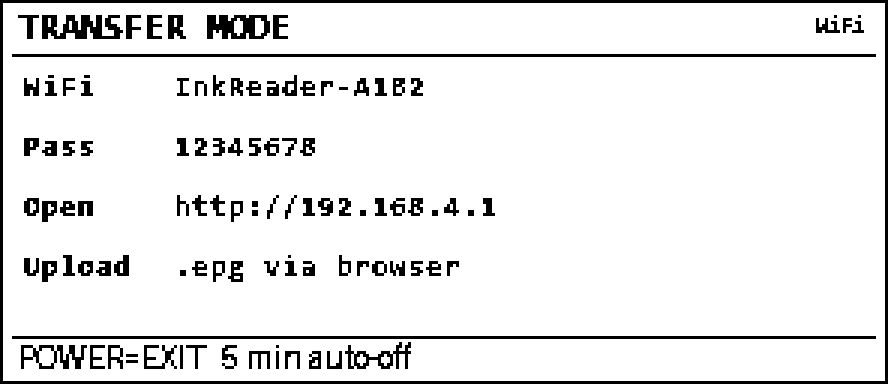

# 12 UI 草案（v1，2.9 寸 296×128）

> 状态：**书库/阅读页/休眠页/续读已在实机实现（2026-11-01）**；菜单和设置仍是草案。
> 图片由 `docs/ui/gen_mockups.py` 生成，只用于评审布局；实机字体是固件 5×7 点阵，
> 中文书名直接取每本书第 1 页的页眉位图，不额外存字体。
>
> 架构见 [10-架构与接口.md](10-架构与接口.md)，采购见 [11-硬件与采购.md](11-硬件与采购.md)。



---

## 1. 设计约束

| 约束 | 数值/影响 |
|---|---|
| 分辨率 | 296×128，1bpp，只有黑/白 |
| 全刷 | 约 2.26 秒，会闪 |
| 局刷 | 约 0.95 秒，不闪；当前是整屏局刷 |
| 正文 | 15px，每页 5 行，页眉 13px，无页脚 |
| 按键 | 4 个：PREV / NEXT / OK / POWER |
| 触摸 | 无 |
| 字号 | 英文 UI 用 5×7 点阵；中文书名用 PC 预渲染位图条 |
| 菜单 | 一屏 4 行，选中行反白 |

**核心原则：不为动画刷屏。** 每次按键最多一次局刷；能整页切换就不做光标动画。

---

## 2. 版面网格

```
┌──────────────────────────────────────┐ 0
│ 标题 / 电量                     13px │
│──────────────────────────────────────│ 18
│ 行 1                          22px   │
│ 行 2                          22px   │
│ 行 3                          22px   │
│ 行 4                          22px   │
│──────────────────────────────────────│ 112
│ 按键提示                        12px │
└──────────────────────────────────────┘ 128
```

- 边框 1px，贴边。
- 标题区 18px；正文/列表区 4×22px；底部提示 12px。
- 阅读页不套这个网格：直接用现有 `render_page()` 的 15px/5 行版式，页眉已经带书名和页码。
- 列表选中行：整行黑底白字（`fill_rect` + 反色文字），不做圆角/阴影。

---

## 3. 六个屏

### 3.1 书库 / 首页



- 有上次进度时开机直接回阅读页；没有进度才进书库。POWER 短按可从阅读页回书库。
- 标题 `INK READER`；右上角电池图标 + 百分比。
- 4 行书；每行：书名位图条（取该书**当前页**页眉，15px），所以右侧页码就是实际页码。
- 选中行整行黑底白字；未选中行底部 1px 分隔线。
- 底部：`OK=OPEN   NEXT=DOWN   POWER=SLEEP`。
- 超过 4 本：`NEXT` 移到底部后翻页，或按页滚动；v1 先做"翻页式列表"。
- 没有书：显示 `NO BOOKS` + `CONNECT USB TO UPLOAD`。

### 3.2 阅读页



- 直接使用现有 PC 排版：15px、5 行、页眉 13px、边框贴边。
- 页眉由 `.epg` 烘焙：`书名  p3/128`。
- 不在阅读页叠加电池/时钟，避免每页多一次局刷。
- 翻页：局刷；每 20 页全刷一次清残影。
- 底部不显示按键提示，把 12px 留给正文（与现有版式一致）。

### 3.3 菜单



- 标题 `MENU`；右上角当前书名。
- 完整菜单预留 4 项：`Contents` / `Bookmarks` / `Reading settings` / `Back to library`。
- **v1 只启用 `Reading settings` + `Back to library`**；其余两项先不实现，后续通过同一 `Menu` 屏幕扩展。
- 右侧可显示简短值（章节数、书签数、刷新页数）；v1 的 Settings 行显示当前刷新/休眠值。
- 上图是"完整版"示意；v1 实机会少两行，其余布局不变。

### 3.4 设置



- 4 行：`Refresh every` / `Sleep after` / `Battery` / `About`。
- 左标题、右值；OK 切换/进入，PREV/NEXT 移动。
- v1 只做：刷新节奏（10/20/30）、休眠时间（1/5/10 分钟）、电池只读、About。
- 格式化存储/恢复出厂设置放到 v1.1，且要长按确认。

### 3.5 传书模式（v0.5，后置）



- 这是 WiFi AP 方案的草图，v1 不实现。
- 显示 SSID、密码、网关地址、上传方式。
- 5 分钟无操作自动关 WiFi 并休眠；POWER 退出。
- PC/手机浏览器打开 `http://192.168.4.1` 上传 `.epg`。
- 串口传书不需要这个屏，v1 用 `upload.py` 即可。

### 3.6 休眠


- 全刷一次，显示 `SLEEP` + 当前书名 + 页码 + `Press any key to wake`。
- 之后 `epd.sleep()` + 深睡；面板保持这幅图。
- 也可以显示自定义 `/system/sleep.bmp`；v1 先用内置版式。
- 唤醒后回到阅读页；如果页面没变，不重绘。

---

## 4. 按键与焦点

| 场景 | PREV | NEXT | OK | POWER |
|---|---|---|---|---|
| 书库 | 上移 | 下移 | 打开 | 休眠 |
| 阅读 | 上一页 | 下一页 | 全刷 | 短按回书库 / 长按休眠 |
| 菜单 | 上移 | 下移 | 进入/切换 | 返回 |
| 设置 | 上移 | 下移 | 切换 | 返回 |
| 传书 | — | — | — | 退出 |

- 选中行反白；没有光标闪烁、没有过渡动画。
- 长按 NEXT 连续翻页（500ms 重复）；长按 PREV 连续上翻。
- 刷新期间按键进队列，不丢；一次最多处理 1 个翻页，避免连翻 10 页。
- 组合键（PREV+NEXT 2 秒 = 强制全刷）可作为调试后门，不放进正式 UI。

---

## 5. 字体与中文

- 英文 UI：固件自带 5×7 ASCII，`draw_text(scale=2)` 约 10×14；预览图用近似字体。
- 中文书名：PC 在生成 `.epg` 时额外渲染 296×16 的 1bpp 标题条，设备直接 blit；
  这样 v1 不需要中文字库。
- 中文正文：已经烘焙在每页位图里，不存在设备端字体问题。
- v2 再考虑 16×16 中文点阵（UI 常用 50–100 字，约 2–3KB），用于菜单/设置的中文化。

---

## 6. 与现有功能的关系

| 现有 | UI 之后 |
|---|---|
| `push.ps1` 推文字/图片 | 不变；收到帧直接显示，按任意键回书库 |
| `push.ps1 -Book` | 不变；PC 整屏推图 |
| `read.py` 键盘翻页 | 不变；仍走 `0xAA55` 帧 |
| 开机 uptime 首页 | 改为书库/上次阅读页；`READY.` 仍打印 |
| 无按键 | 4 键；`EPD_HAS_KEYS` 真正生效 |
| 无书库 | 新增书库；没有书时显示上传提示 |

**阅读页的像素输出与现在 `push.py` 的 2.9 寸版式一致**，不会因为 UI 重做而改变字号/行数。

---

## 7. 已确认 / 待确认

已确认：

| 项 | 结论 |
|---|---|
| 书库行数 | **4 行**，不再改 5 行小字 |
| 选中样式 | **整行反白**，不做 `>` 光标动画 |
| 菜单 v1 | **只保留 `Reading settings` + `Back`**；Contents/Bookmarks 后续扩展 |
| 菜单结构 | 统一 `Menu` 屏幕 + 可增删的 item 列表，后续加项不改框架 |

仍待确认：

1. 阅读页要不要在底部加 1px 进度条？会占正文 2–3px。
2. 传书模式是否按这个草图做（WiFi AP + 浏览器）？
3. 休眠图用内置版式，还是允许 `/system/sleep.bmp` 自定义？

---

## 8. 生成方式

```powershell
cd D:\04-Code\08-deepseek-harness\epaper29\docs\ui
..\..\.venv\Scripts\python.exe gen_mockups.py
```

- 输出 `01-home.png` … `06-sleep.png`（296×128 原始尺寸）
- 以及 `*-3x.png`（3 倍放大预览）和 `00-contact-sheet.png`
- 该脚本只生成文档图片，不碰固件。
